# Casos de verificación

Este documento reúne los casos con los que comprobamos que el sistema cumple lo pedido en la consigna. Para cada caso se indican los pasos, el resultado esperado, el resultado que obtuvimos y las capturas de pantalla que lo muestran.

**Punto de partida:** datos de demostración nuevos. Para obtenerlos hay que cerrar el programa, borrar `datos/cine.dat` y volver a abrirlo (ver "Volver a los datos de demostración" en el README).

**Fecha de la verificación:** 22/11/2026, a partir de las 20:44. Por eso en las capturas "mañana" es el 23/11/2026 y "pasado mañana" el 24/11/2026.

**Versiones:** Java 25 (25.0.4) y JavaFX 25 (SDK 25.0.5).

**Orden de los casos:** los casos 1 a 5, 7, 8, 10 y 11 se hicieron uno detrás de otro sobre los mismos datos, en este orden: 11, 1, 2, 3, 4, 7, 5, 10 y 8. El caso 11 va primero porque la función en emisión de la demostración solo dura dos horas desde el primer inicio. Los códigos de reserva que aparecen (CIN-006, CIN-007, etc.) dependen de ese orden. Los casos 6 y 9 se hicieron aparte, con otros datos de demostración nuevos, porque necesitan cerrar y volver a abrir el programa.

## Resumen

| # | Caso | Resultado |
|---|---|---|
| 1 | Reserva de varias butacas | Cumple |
| 2 | Rechazo de una butaca ocupada | Cumple |
| 3 | Reserva de la misma ubicación en otra función | Cumple |
| 4 | Cancelación y reutilización de butacas | Cumple |
| 5 | Rechazo de funciones superpuestas | Cumple |
| 6 | Recuperación de datos tras reiniciar | Cumple |
| 7 | Precios por polimorfismo | Cumple |
| 8 | Exportación | Cumple |
| 9 | Guardado y recuperación del estado completo por serialización | Cumple |
| 10 | Datos incompletos o incorrectos sin cierre inesperado | Cumple |
| 11 | Estados de la función | Cumple |

## Caso 1: Reserva de varias butacas

**Objetivo:** reservar dos butacas en una función, desde la cartelera hasta el comprobante.

**Pasos:**

1. Abrir **Cartelera**.
2. En la fila de Órbita, Sala 1, mañana 18:00, presionar **Reservar →**.
3. Elegir las butacas C3 y C4 y presionar **Continuar →**.
4. Escribir la identificación `40111222` y el nombre `Sofía Ramírez`. Dejar las dos entradas como General y presionar **Revisar reserva →**.
5. Presionar **Confirmar reserva**.

**Resultado esperado:** la revisión muestra las dos butacas a $ 5.000 cada una y un total de $ 10.000. Al confirmar se muestra el comprobante con un código nuevo, las dos butacas y el importe.

**Resultado obtenido:** la cartelera muestra las cinco funciones vigentes. En la grilla, C3 y C4 quedan oscuras y el resumen dice "Butacas: C3, C4 · Cantidad: 2". La revisión muestra C3 y C4 como General a $ 5.000 y "Total: $ 10.000". Al confirmar aparece "Reserva confirmada · CIN-006" con C3 y C4 e "Importe confirmado: $ 10.000".

**Evidencia:**

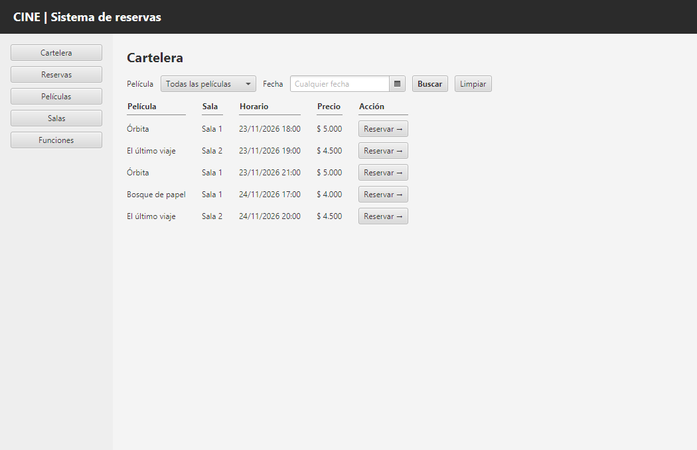
Cartelera con las funciones vigentes.

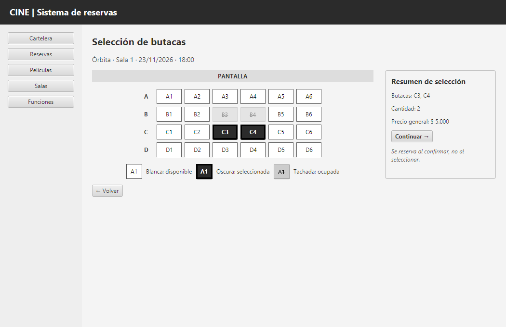
C3 y C4 seleccionadas en Órbita, Sala 1, 23/11/2026 18:00.


Revisión antes de confirmar, con el total de $ 10.000.


Comprobante de la reserva CIN-006.

## Caso 2: Rechazo de una butaca ocupada

**Objetivo:** comprobar que una butaca ocupada no se puede elegir y que, si se ocupa mientras se completa otra reserva, la confirmación se rechaza.

**Pasos:**

1. Abrir **Cartelera** y, en la fila de El último viaje, Sala 2, mañana 19:00, presionar **Reservar →**. A3 y A4 están ocupadas por la reserva de Lucía Pérez de la demostración.
2. Elegir A5 y presionar **Continuar →**.
3. Escribir la identificación `36777888` y el nombre `Pablo Ríos`, y presionar **Revisar reserva →**.
4. Con la pantalla de revisión abierta, se registra en el mismo sistema una reserva confirmada de A5 para esa función, a nombre de `Carlos Díaz` (`31222333`), como la haría un segundo operador. La aplicación tiene una sola ventana, así que esta situación no se puede armar a mano con un solo operador; ver la nota del final.
5. Presionar **Confirmar reserva**.
6. Presionar **Aceptar** en el aviso, luego **← Corregir datos** y después **← Butacas**.

**Resultado esperado:** en la grilla, A3 y A4 aparecen tachadas y no se pueden presionar. Al confirmar, el sistema vuelve a revisar la disponibilidad y rechaza la reserva porque A5 ya está ocupada. Al volver a las butacas, A5 se quita de la selección con un aviso y aparece tachada.

**Resultado obtenido:** A3 y A4 aparecen tachadas, en gris y deshabilitadas. Al confirmar aparece el aviso "No se puede realizar la operación: La butaca A5 ya está ocupada en esta función." y la pantalla de revisión queda como estaba. Al volver a las butacas aparece el aviso "Estas butacas ya no están disponibles y se quitaron de la selección: A5.". La grilla muestra A3, A4 y A5 tachadas, el resumen dice "Butacas: ninguna" y **Continuar →** queda deshabilitado. La reserva de Carlos Díaz quedó como CIN-007.

**Evidencia:**


A3 y A4 tachadas y deshabilitadas.

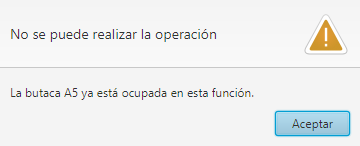
Aviso de rechazo al confirmar con A5 ya ocupada.

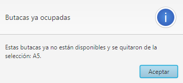
Aviso al volver a la selección de butacas.

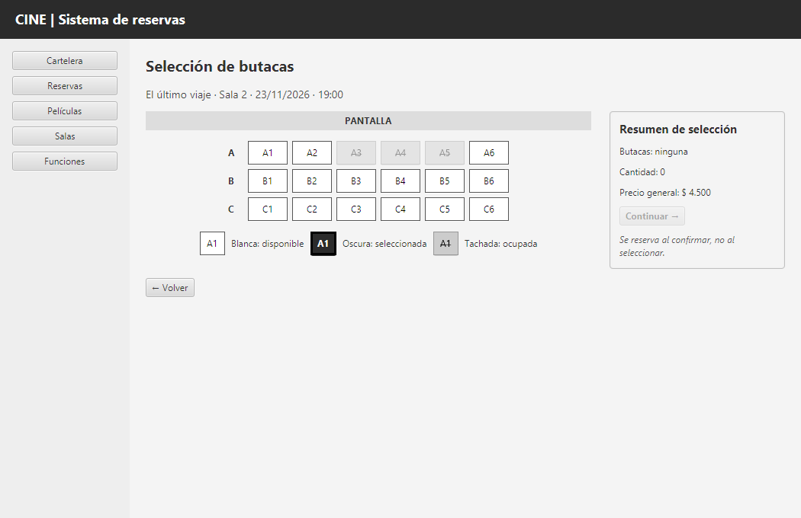
A5 tachada y la selección vacía.

## Caso 3: Reserva de la misma ubicación en otra función

**Objetivo:** comprobar que la misma butaca se puede reservar en dos funciones distintas.

**Pasos:**

1. Partir de la reserva CIN-006 del caso 1, que tiene C3 en Órbita, Sala 1, mañana 18:00.
2. Abrir **Cartelera** y, en la fila de Bosque de papel, Sala 1, pasado mañana 17:00, presionar **Reservar →**.
3. Elegir C3 y presionar **Continuar →**.
4. Escribir la identificación `29333444` y el nombre `Julián Torres`, presionar **Revisar reserva →** y luego **Confirmar reserva**.
5. Abrir **Reservas** y presionar **Ver detalle →** en CIN-006.

**Resultado esperado:** la segunda reserva se confirma, porque la ocupación es de cada función. La primera sigue confirmada.

**Resultado obtenido:** aparece "Reserva confirmada · CIN-008" con C3 en Bosque de papel, Sala 1, 24/11/2026 17:00. El detalle de CIN-006 muestra "Confirmada" con C3 y C4 en Órbita, Sala 1, 23/11/2026 18:00.

**Evidencia:**

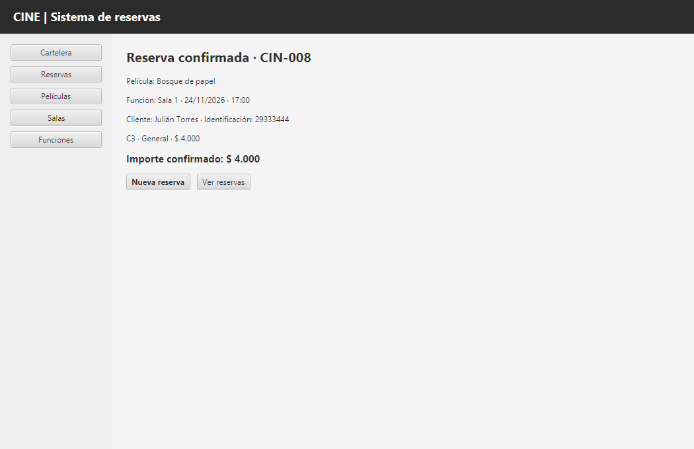
C3 confirmada en Bosque de papel, 24/11/2026 17:00.

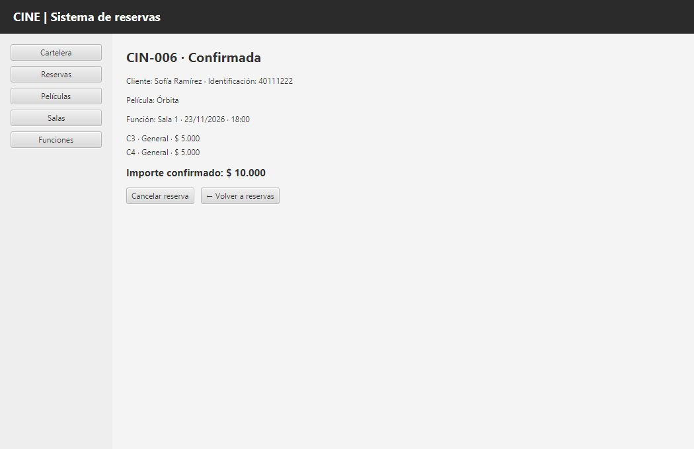
C3 sigue confirmada en Órbita, 23/11/2026 18:00.

## Caso 4: Cancelación y reutilización de butacas

**Objetivo:** cancelar una reserva confirmada de una función vigente y volver a reservar las mismas butacas.

**Pasos:**

1. Abrir **Reservas** y presionar **Ver detalle →** en CIN-001 (Lucía Pérez, A3 y A4 en El último viaje, Sala 2, mañana 19:00).
2. Presionar **Cancelar reserva** y elegir **Sí, cancelar**.
3. Abrir **Cartelera** y, en la fila de El último viaje, Sala 2, mañana 19:00, presionar **Reservar →**.
4. Elegir A3 y A4 y presionar **Continuar →**.
5. Escribir la identificación `34888999` y el nombre `Laura Méndez`, presionar **Revisar reserva →** y luego **Confirmar reserva**.

**Resultado esperado:** antes de cancelar se pide confirmación indicando qué butacas se liberan. La reserva queda cancelada en el historial y A3 y A4 vuelven a estar libres para otra reserva.

**Resultado obtenido:** el aviso pregunta "¿Cancelar la reserva CIN-001?" y dice "Se liberarán A3 y A4. La reserva quedará en el historial.". Después el detalle muestra "CIN-001 · Cancelada", sin el botón de cancelar. En la grilla A3 y A4 se pueden elegir (A5 sigue tachada por el caso 2). La nueva reserva queda confirmada como CIN-009 con A3 y A4 e importe $ 9.000.

**Evidencia:**

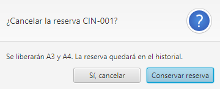
Pedido de confirmación con las butacas que se liberan.

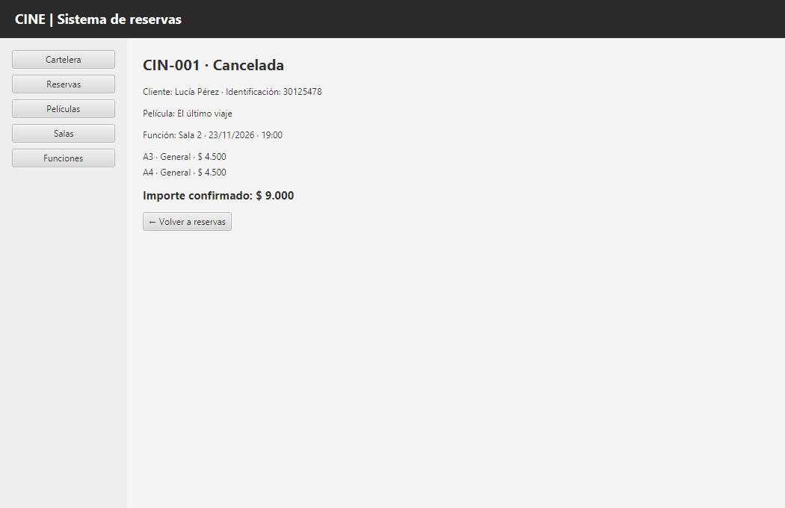
CIN-001 queda cancelada en el historial.

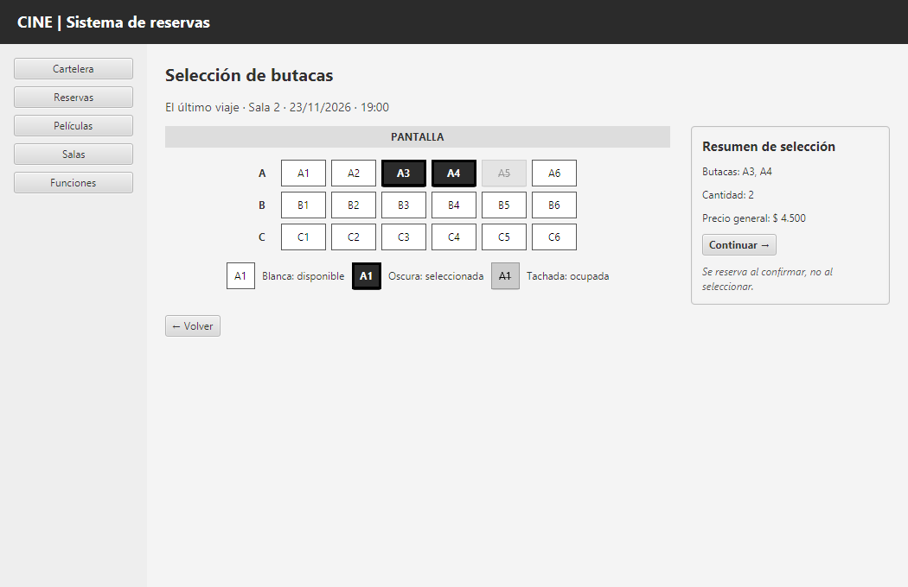
A3 y A4 elegidas otra vez en la misma función.

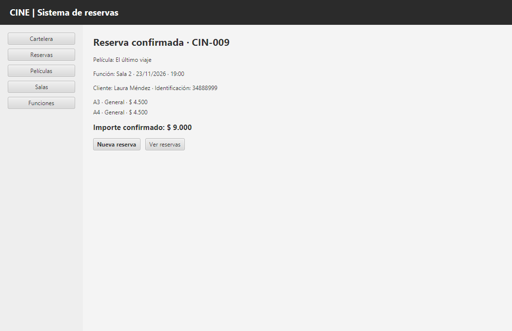
CIN-009 con A3 y A4.

## Caso 5: Rechazo de funciones superpuestas

**Objetivo:** comprobar que no se puede programar una función que choca con otra de la misma sala, ni cuando el choque es solo por el margen de limpieza de 15 minutos.

En la Sala 2, pasado mañana, ya está El último viaje de 20:00 a 21:45 (105 minutos). Bosque de papel dura 90 minutos.

**Pasos:**

1. Abrir **Funciones** y presionar **Registrar función**.
2. Elegir Película `Bosque de papel`, Sala `Sala 2`, Fecha pasado mañana, Inicio `21:00` y Precio general `4000`. Presionar **Guardar función**.
3. Presionar **Aceptar** en el aviso, cambiar Inicio a `18:20` y presionar **Guardar función**.

**Resultado esperado:** con inicio 21:00 la función nueva ocupa la sala mientras se proyecta la otra, y se rechaza por superposición directa. Con inicio 18:20 termina a las 19:50 y la sala queda libre a las 20:05, cinco minutos después de que empieza la otra función: se rechaza y el mensaje explica que falta el margen.

**Resultado obtenido:** con inicio 21:00 el formulario muestra "Finalización calculada: 22:30" y el aviso dice "El horario se superpone con la función de "El último viaje" de 20:00 a 21:45 en esa sala.". Con inicio 18:20 el formulario muestra "Finalización calculada: 19:50" y "La sala queda libre desde las 20:05", y el aviso dice "La función siguiente de la sala empieza a las 20:00: se necesitan 15 minutos de margen después del fin de la nueva función (19:50).". En los dos casos no se registró ninguna función nueva.

**Evidencia:**

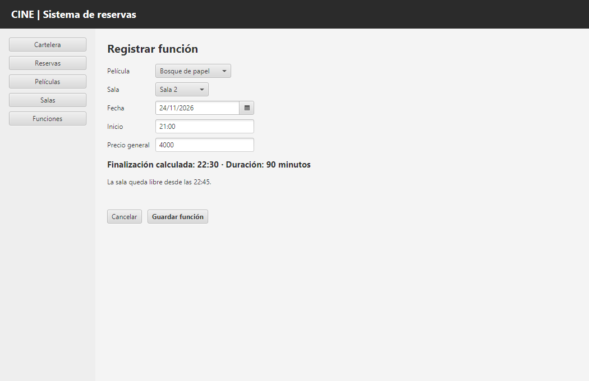
Datos de la función de las 21:00.

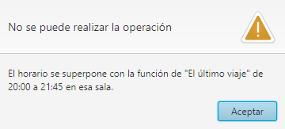
Rechazo por choque con El último viaje de 20:00 a 21:45.


Datos de la función de las 18:20, que libera la sala a las 20:05.

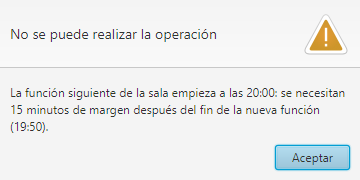
Rechazo que explica el margen de 15 minutos.

## Caso 6: Recuperación de datos tras reiniciar

**Objetivo:** comprobar que una reserva y sus butacas ocupadas siguen estando después de cerrar y volver a abrir el programa.

**Pasos:**

1. Con datos de demostración nuevos, abrir **Cartelera** y, en la fila de Órbita, Sala 1, mañana 18:00, presionar **Reservar →**.
2. Elegir D3 y D4, presionar **Continuar →**, escribir la identificación `37444555` y el nombre `Valeria Suárez`, presionar **Revisar reserva →** y luego **Confirmar reserva**.
3. Cerrar el programa por completo.
4. Volver a abrirlo sobre el mismo archivo de datos.
5. Abrir **Reservas**, escribir `37444555` y presionar **Buscar**.
6. Abrir **Cartelera** y, en la fila de Órbita, Sala 1, mañana 18:00, presionar **Reservar →**.

**Resultado esperado:** después de reiniciar, la reserva aparece confirmada y D3 y D4 aparecen ocupadas en la grilla de esa función.

**Resultado obtenido:** antes de cerrar se confirmó CIN-006 con D3 y D4 por $ 10.000. Después de volver a abrir, la búsqueda por `37444555` muestra CIN-006, Valeria Suárez, Confirmada. En la grilla de Órbita 18:00 aparecen tachadas D3 y D4, además de B3 y B4 de la demostración.

**Evidencia:**


CIN-006 confirmada antes de cerrar el programa.

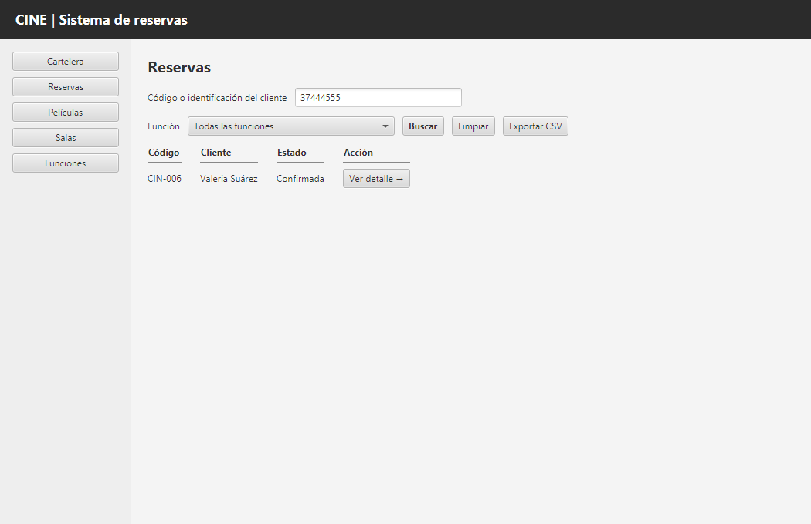
La reserva sigue confirmada después de volver a abrir.

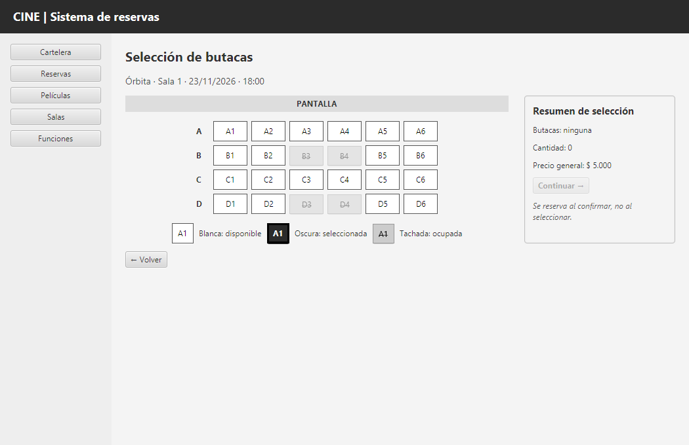
D3 y D4 siguen ocupadas.

## Caso 7: Precios por polimorfismo

**Objetivo:** comprobar que cada tipo de entrada calcula su propio precio: la general cobra el precio de la función y la de estudiante tiene un 20 % de descuento.

**Pasos:**

1. Abrir **Cartelera** y, en la fila de Órbita, Sala 1, mañana 21:00 ($ 5.000), presionar **Reservar →**.
2. Elegir B1 y B2 y presionar **Continuar →**.
3. Escribir la identificación `38999000` y el nombre `Martina Silva`. Dejar B1 como General y cambiar B2 a Estudiante.
4. Presionar **Revisar reserva →** y luego **Confirmar reserva**.

**Resultado esperado:** B1 a $ 5.000 y B2 a $ 4.000 (5.000 menos el 20 %), total $ 9.000, igual en las tres pantallas.

**Resultado obtenido:** en "Cliente y entradas" B1 General muestra $ 5.000, B2 Estudiante $ 4.000 y "Total: $ 9.000". La revisión muestra los mismos precios y total. El comprobante CIN-010 muestra "B1 · General · $ 5.000", "B2 · Estudiante · $ 4.000" e "Importe confirmado: $ 9.000".

**Evidencia:**

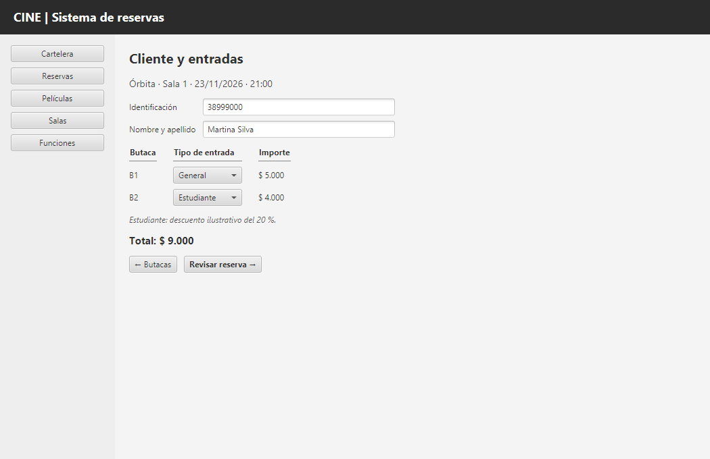
Importe de cada entrada según su tipo.

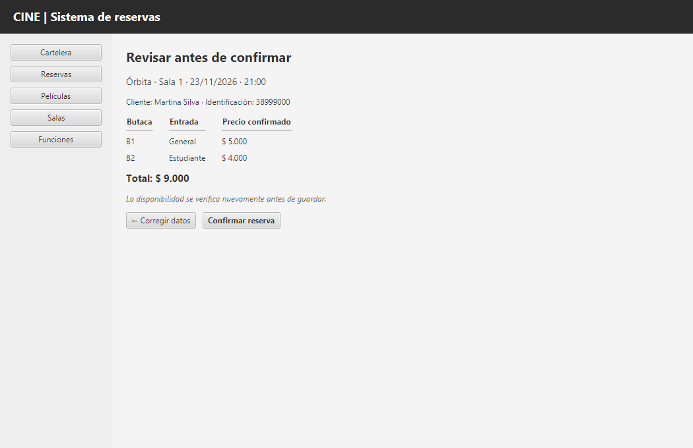
Precios confirmados en la revisión.


Comprobante CIN-010 con una entrada de cada tipo.

## Caso 8: Exportación

**Objetivo:** exportar todas las reservas, confirmadas y canceladas, a un archivo CSV.

**Pasos:**

1. Abrir **Reservas** (sin filtros se listan todas).
2. Presionar **Exportar CSV**, elegir dónde guardar el archivo y aceptar.
3. Abrir el archivo con una planilla de cálculo, usando `;` como separador.

**Resultado esperado:** un archivo con una fila de encabezados y una fila por reserva, incluidas las canceladas, con cliente, función, butacas e importe.

**Resultado obtenido:** la pantalla de Reservas muestra las diez reservas y el botón **Exportar CSV**. El archivo generado tiene el encabezado y diez filas, una por reserva, con las canceladas (CIN-001, CIN-003 y CIN-005) incluidas. El cuadro para elegir dónde guardar es una ventana del sistema operativo y no se capturó; ver la nota del final. El contenido del archivo es este:

```text
Código;Estado;Cliente;Identificación;Película;Sala;Fecha;Hora;Butacas;Importe total
CIN-001;Cancelada;Lucía Pérez;30125478;El último viaje;Sala 2;23/11/2026;19:00;A3, A4;9000
CIN-002;Confirmada;Martín Gómez;28456913;Órbita;Sala 1;23/11/2026;18:00;B3, B4;9000
CIN-003;Cancelada;Ana López;35872046;Órbita;Sala 1;23/11/2026;18:00;C5;4000
CIN-004;Confirmada;Martín Gómez;28456913;El último viaje;Sala 2;21/11/2026;20:00;B2;4500
CIN-005;Cancelada;Diego Fernández;32904517;Órbita;Sala 1;22/11/2026;20:24;D1, D2;10000
CIN-006;Confirmada;Sofía Ramírez;40111222;Órbita;Sala 1;23/11/2026;18:00;C3, C4;10000
CIN-007;Confirmada;Carlos Díaz;31222333;El último viaje;Sala 2;23/11/2026;19:00;A5;4500
CIN-008;Confirmada;Julián Torres;29333444;Bosque de papel;Sala 1;24/11/2026;17:00;C3;4000
CIN-009;Confirmada;Laura Méndez;34888999;El último viaje;Sala 2;23/11/2026;19:00;A3, A4;9000
CIN-010;Confirmada;Martina Silva;38999000;Órbita;Sala 1;23/11/2026;21:00;B1, B2;9000
```

El archivo está en UTF-8 con marca de orden de bytes. Para abrirlo en una planilla de cálculo hay que indicar `;` como separador de columnas.

**Evidencia:**

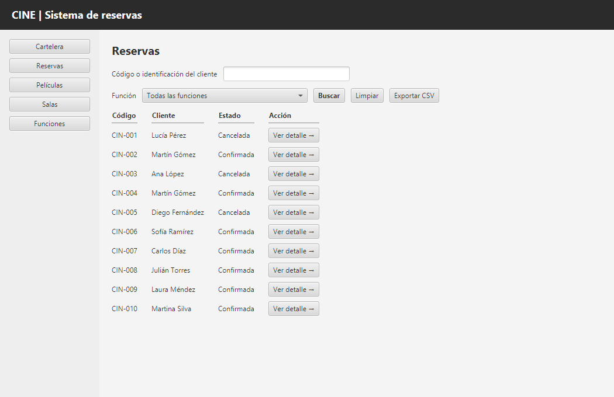
Listado completo de reservas con el botón Exportar CSV.

## Caso 9: Guardado y recuperación del estado completo por serialización

**Objetivo:** comprobar que una película, una sala, una función y una reserva nuevas se recuperan completas después de reiniciar.

**Pasos:**

1. Con los mismos datos del caso 6, abrir **Películas**, presionar **Registrar película**, escribir Título `Mar adentro` y Duración `95`, y presionar **Guardar**.
2. Abrir **Salas**, presionar **Registrar sala**, escribir Nombre `Sala 3`, Cantidad de filas `5` y Butacas por fila `8`, y presionar **Guardar sala**.
3. Abrir **Funciones**, presionar **Registrar función**, elegir `Mar adentro`, `Sala 3`, pasado mañana, Inicio `15:00`, Precio general `3500`, y presionar **Guardar función**.
4. Abrir **Cartelera**, presionar **Reservar →** en la fila de Mar adentro, elegir E8, escribir la identificación `33555666` y el nombre `Tomás Herrera`, revisar y confirmar.
5. Cerrar el programa por completo y volver a abrirlo sobre el mismo archivo de datos.
6. Abrir **Películas**, **Salas**, **Funciones** y **Reservas**.

**Resultado esperado:** los cuatro elementos nuevos aparecen después de reiniciar, con sus datos.

**Resultado obtenido:** antes de cerrar se confirmó CIN-007 para Mar adentro, Sala 3, 24/11/2026 15:00, butaca E8, $ 3.500. Después de volver a abrir: Películas muestra "Mar adentro · 95 min · Activa"; Salas muestra "Sala 3 · 5 filas · 8 butacas por fila · 40 butacas · Habilitada"; Funciones muestra "Mar adentro · Sala 3 · 24/11/2026 · 15:00 · $ 3.500 · Vigente"; Reservas muestra "CIN-007 · Tomás Herrera · Confirmada", junto con CIN-006 del caso 6.

**Evidencia:**

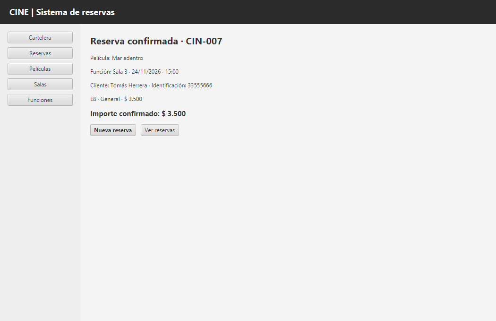
Reserva en la función nueva, antes de cerrar.

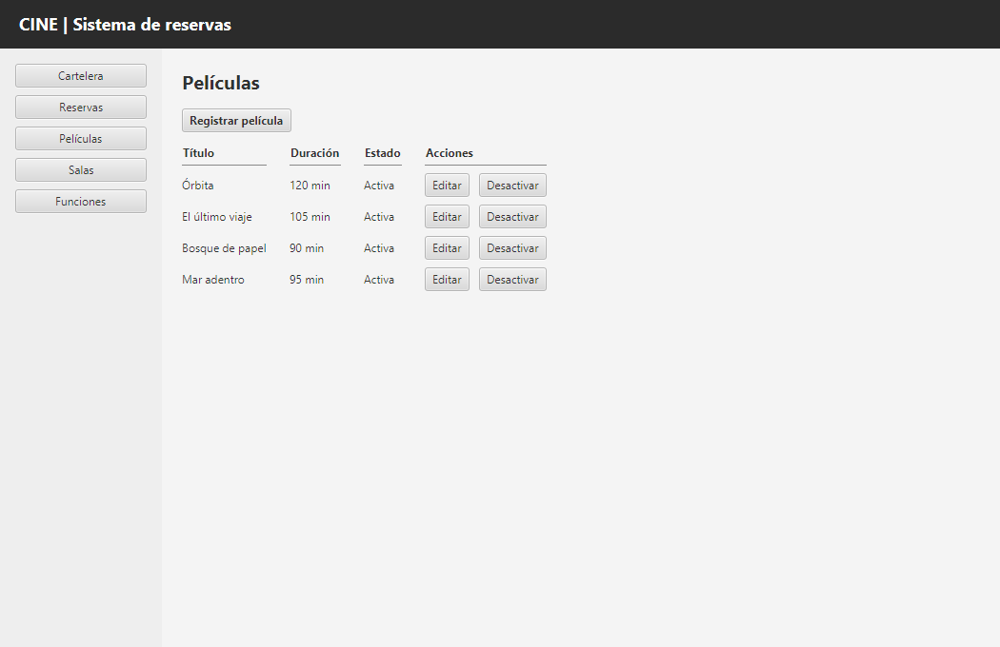
Mar adentro sigue registrada.

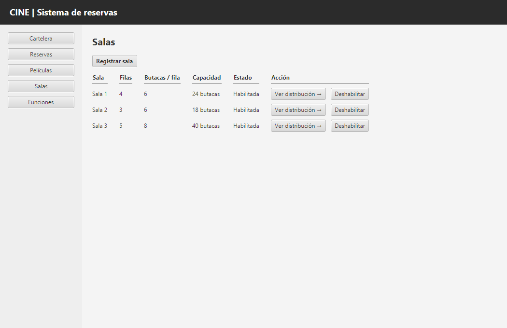
Sala 3 sigue registrada con su distribución.

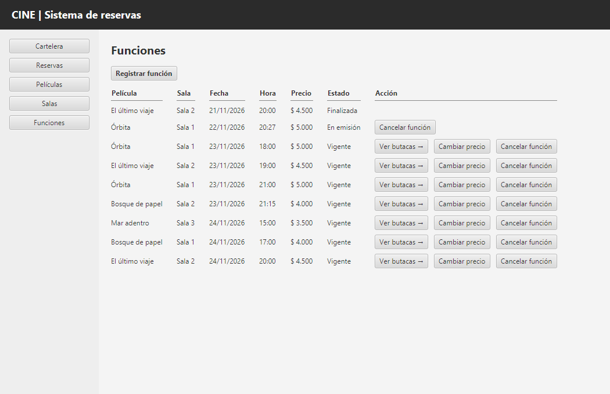
La función de Mar adentro en la Sala 3 sigue programada.

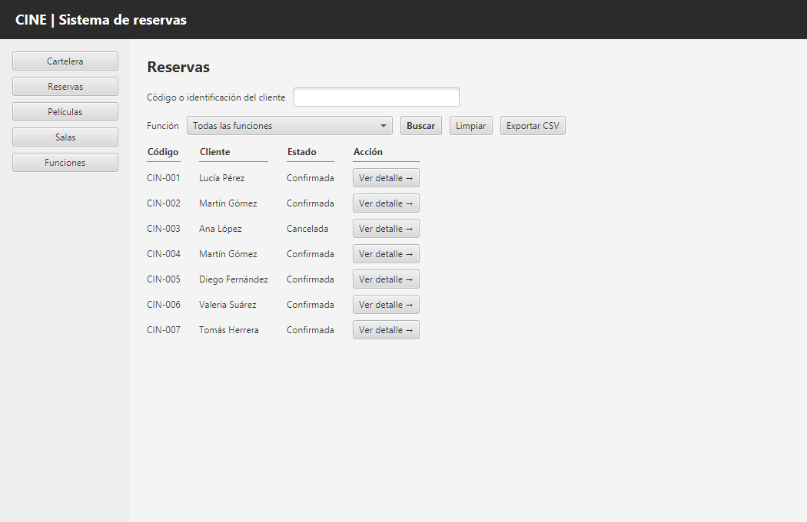
CIN-007 de Tomás Herrera sigue confirmada.

## Caso 10: Datos incompletos o incorrectos sin cierre inesperado

**Objetivo:** comprobar que cada dato inválido se informa con un mensaje claro y que la aplicación sigue abierta, con lo escrito conservado.

**Pasos:**

1. **Películas** → **Registrar película**: Título `Prueba`, Duración `dos horas`, **Guardar**. Presionar **Aceptar**.
2. En el mismo formulario: Título vacío, Duración `100`, **Guardar**. Presionar **Aceptar** y luego **Cancelar**.
3. **Funciones** → **Registrar función**: `Órbita`, `Sala 2`, pasado mañana, Inicio `10:00`, Precio general `5.000`, **Guardar función**. Presionar **Aceptar**.
4. En el mismo formulario: Inicio `25:00`, Precio general `5000`, **Guardar función**. Presionar **Aceptar** y luego **Cancelar**.
5. **Cartelera** → Órbita, Sala 1, mañana 21:00 → **Reservar →**, elegir D6, **Continuar →**, identificación `12345`, nombre `Prueba Corta`, **Revisar reserva →**, **Confirmar reserva**. Presionar **Aceptar**.
6. **Salas** → **Registrar sala**: Nombre `Sala 3`, Cantidad de filas `0`, Butacas por fila `5`, **Guardar sala**. Presionar **Aceptar** y luego **Cancelar**.
7. **Reservas**: escribir `CIN-999` y presionar **Buscar**.

**Resultado esperado:** un aviso por cada dato inválido que explica qué corregir; nada se guarda y la aplicación no se cierra. La búsqueda de una reserva inexistente informa que no hay resultados.

**Resultado obtenido:**

| Dato ingresado | Mensaje mostrado |
|---|---|
| Duración `dos horas` | La duración tiene que ser un número entero de minutos, por ejemplo 120. |
| Título vacío | El título de la película no puede estar vacío. |
| Precio `5.000` | El precio general tiene que ser un número, por ejemplo 5000 o 5000,50 (sin puntos y con coma para los decimales). |
| Inicio `25:00` | El inicio tiene que tener el formato HH:mm, por ejemplo 18:00. |
| Identificación `12345` | La identificación tiene que tener 7 u 8 dígitos, sin puntos ni espacios. |
| Sala con `0` filas | La cantidad de filas tiene que estar entre 1 y 26 (las filas se nombran de la A a la Z). |
| Búsqueda `CIN-999` | No hay reservas para estos filtros (nota en la pantalla, sin aviso). |

Después de cada aviso la aplicación siguió abierta en la misma pantalla y con los datos escritos. Por ejemplo, el formulario de película conserva "Prueba" y "dos horas", y la reserva rechazada por la identificación sigue en la pantalla de revisión. Esa reserva no se registró: el listado del caso 8, hecho después, no la incluye.

**Evidencia:**


Aviso por la duración escrita con letras.

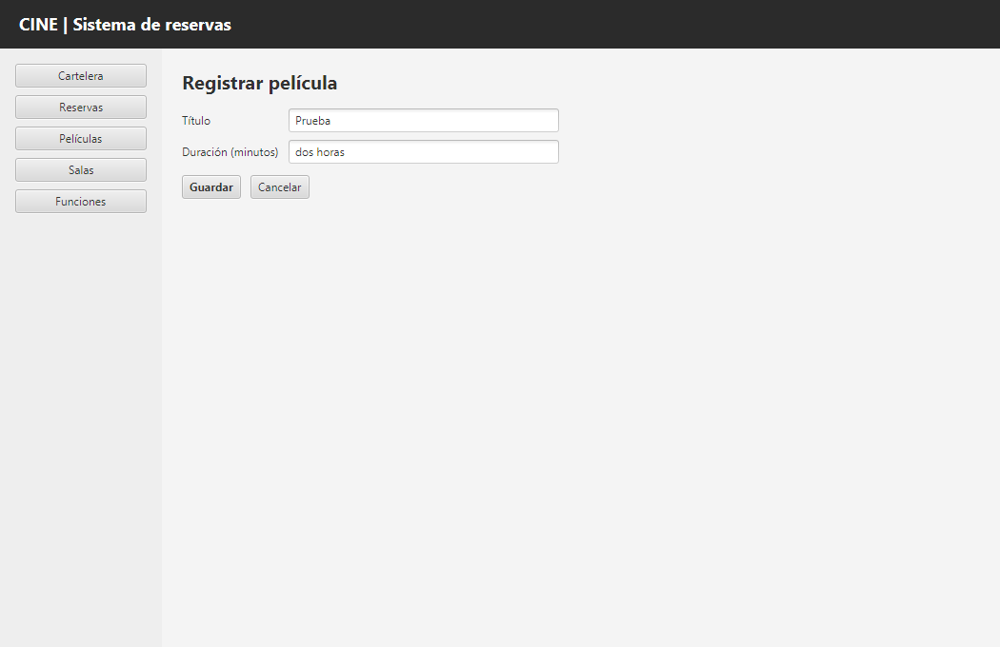
El formulario sigue abierto con lo escrito después del aviso.

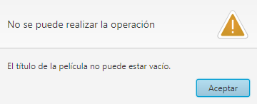
Aviso por el título vacío.

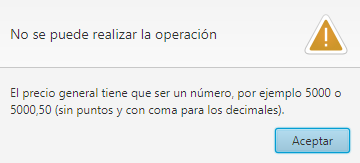
Aviso por el precio escrito con punto.

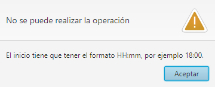
Aviso por el inicio 25:00.

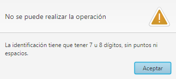
Aviso al confirmar con una identificación de 5 dígitos.

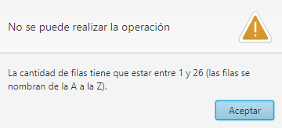
Aviso por la sala con 0 filas.

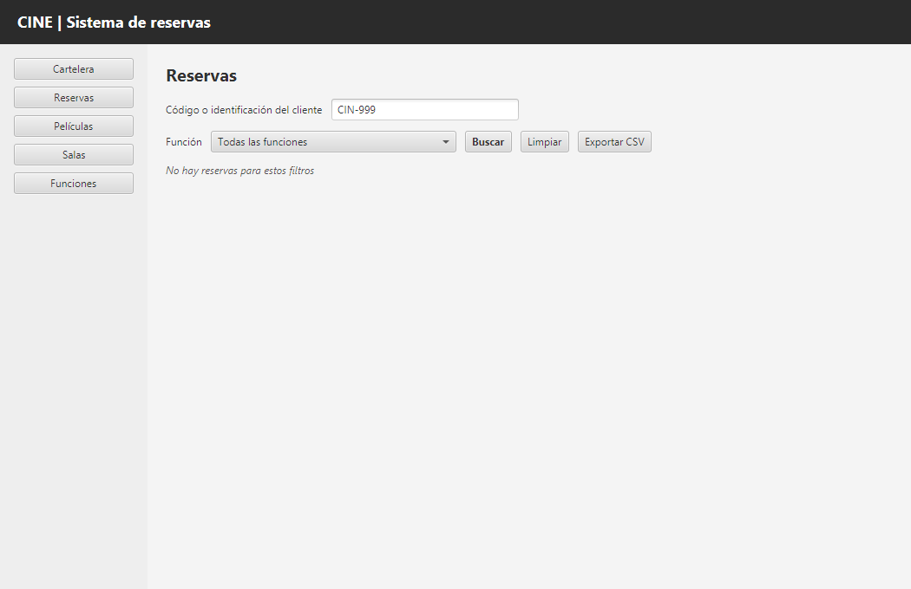
Búsqueda de CIN-999 sin resultados.

## Caso 11: Estados de la función

**Objetivo:** comprobar los cuatro estados de una función (vigente, en emisión, finalizada y cancelada) y lo que se permite hacer en cada uno.

**Pasos:**

1. Con datos de demostración recién creados, abrir **Funciones**.
2. En la fila de Bosque de papel, Sala 2, mañana 21:15, presionar **Cancelar función** y elegir **Sí, cancelar función**.
3. Abrir **Reservas** y presionar **Ver detalle →** en CIN-005 (Diego Fernández, de la función en emisión).
4. Volver a **Reservas** y presionar **Ver detalle →** en CIN-004 (Martín Gómez, de la función de ayer).
5. Abrir **Funciones** y, en la fila de la función En emisión (Órbita, Sala 1, hoy), presionar **Cancelar función**. Elegir **Sí, cancelar función**.
6. Abrir **Reservas** y presionar **Ver detalle →** en CIN-005.

**Resultado esperado:** el listado muestra los cuatro estados. La función en emisión solo ofrece cancelarla, y la finalizada y la cancelada no tienen acciones. Las reservas de funciones en emisión o finalizadas no se pueden cancelar por separado y lo explican con una nota. Al cancelar la función en emisión, el aviso lo advierte y su reserva confirmada también queda cancelada.

**Resultado obtenido:** el listado muestra El último viaje 21/11/2026 20:00 "Finalizada" sin acciones, Órbita 22/11/2026 20:24 "En emisión" solo con **Cancelar función**, Bosque de papel 23/11/2026 21:15 "Cancelada" sin acciones y el resto "Vigente" con **Ver butacas →**, **Cambiar precio** y **Cancelar función**. El detalle de CIN-005 no tiene **Cancelar reserva** y dice "La función está en emisión: la reserva no se puede cancelar por separado, solo cancelando la función completa.". El detalle de CIN-004 tampoco tiene el botón y dice "La función ya finalizó: la reserva no se puede cancelar.". El aviso para cancelar la función en emisión dice "La función está en emisión en este momento." y "La función tiene 1 reserva confirmada que también se va a cancelar.". Después Órbita 20:24 figura "Cancelada" y CIN-005 figura "Cancelada".

**Evidencia:**

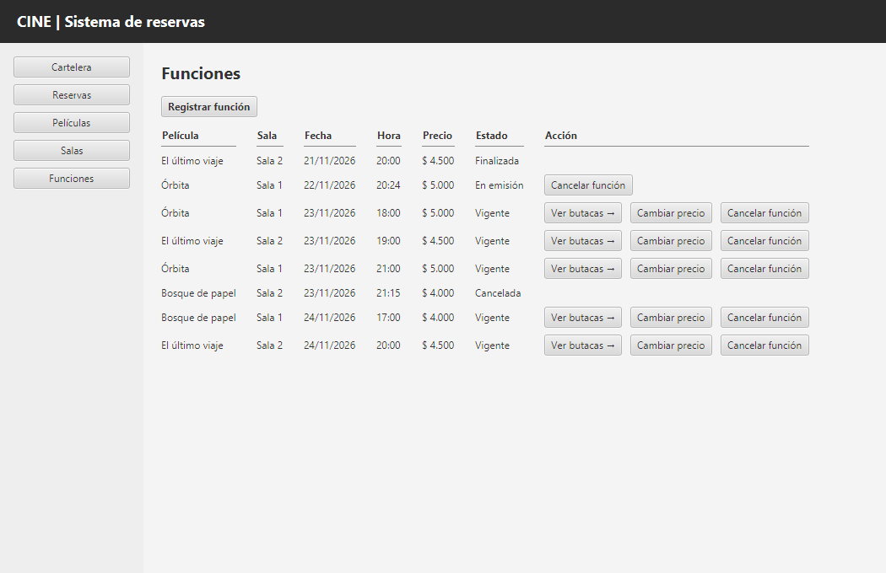
Vigente, En emisión, Finalizada y Cancelada en el mismo listado.

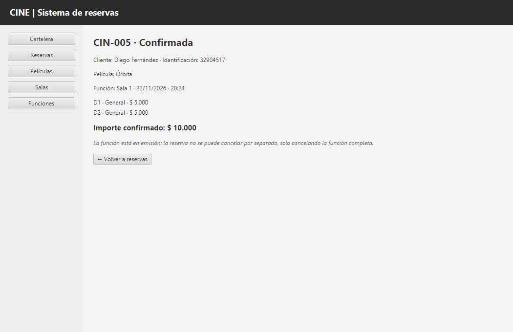
CIN-005 con la nota de función en emisión y sin botón de cancelar.

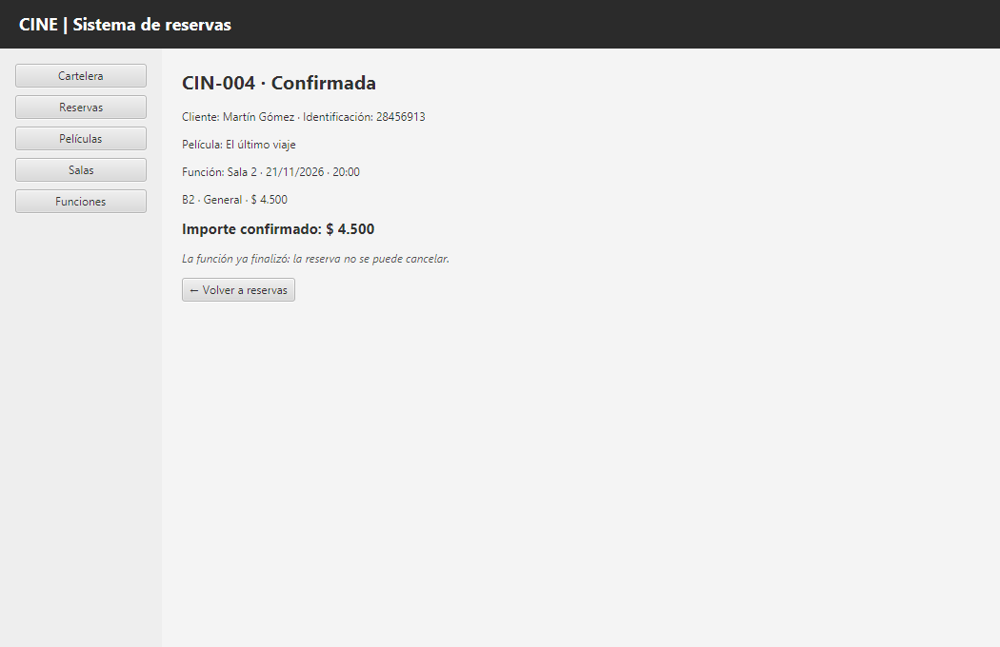
CIN-004 con la nota de función finalizada y sin botón de cancelar.

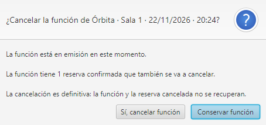
El aviso advierte que la función está en emisión y que tiene una reserva confirmada.

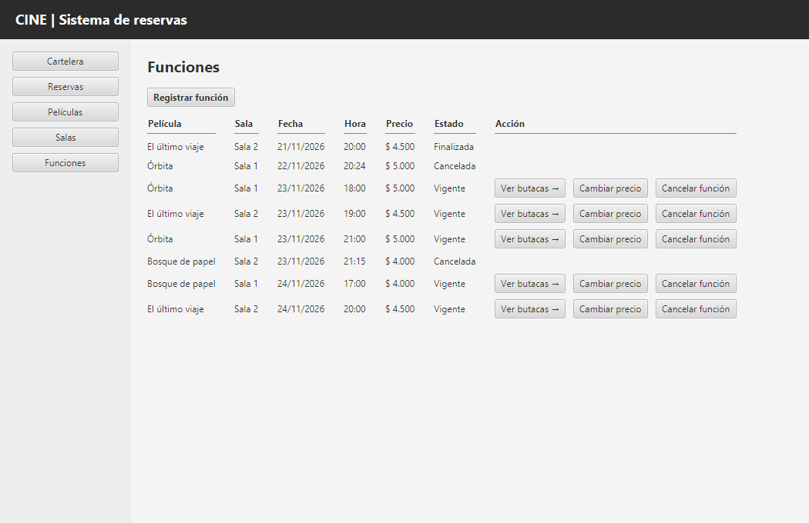
Órbita de las 20:24 pasa a Cancelada.

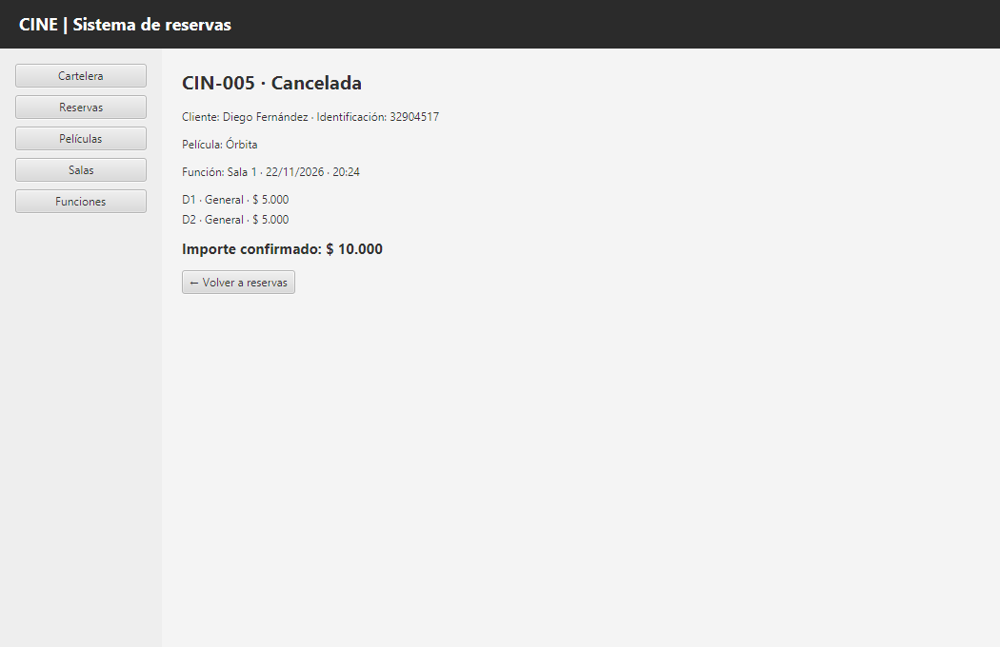
CIN-005 queda cancelada junto con su función.

## Cómo se obtuvieron las evidencias

Las capturas son de la aplicación funcionando el 22/11/2026, con datos de demostración creados para esta verificación en un archivo de datos aparte. No son datos de trabajo de ningún integrante. Cada imagen es la ventana del programa (1050 × 680) o el aviso, tal como se vieron en ese paso y sin retoques. Las capturas de los avisos muestran solo el aviso, no la ventana de atrás.

Los casos 6 y 9 usaron un segundo archivo de datos de demostración nuevo. El programa se cerró por completo y se volvió a abrir sobre ese mismo archivo antes de tomar las capturas "después de reiniciar".

Dos situaciones no se pudieron capturar como las vería una persona usando el programa:

- **Caso 2, reserva de un segundo operador.** La aplicación tiene una sola ventana: mientras alguien está en la pantalla de revisión, nadie más puede confirmar una reserva en ese mismo programa. Para comprobar el control que se hace al confirmar, la reserva de A5 a nombre de Carlos Díaz se registró en el mismo sistema en ejecución sin pasar por la ventana, con la misma operación de confirmar reserva que usa la pantalla. Todo lo demás del caso, incluidos los dos avisos, se hizo desde la ventana.
- **Caso 8, cuadro para elegir dónde guardar.** El botón **Exportar CSV** abre el cuadro de guardado del sistema operativo, que no forma parte de la aplicación, y ese cuadro no se capturó. El archivo que se muestra se generó en la misma sesión con la misma operación de exportar que ejecuta el botón después de elegir el destino. El contenido se copió del archivo tal como quedó.
